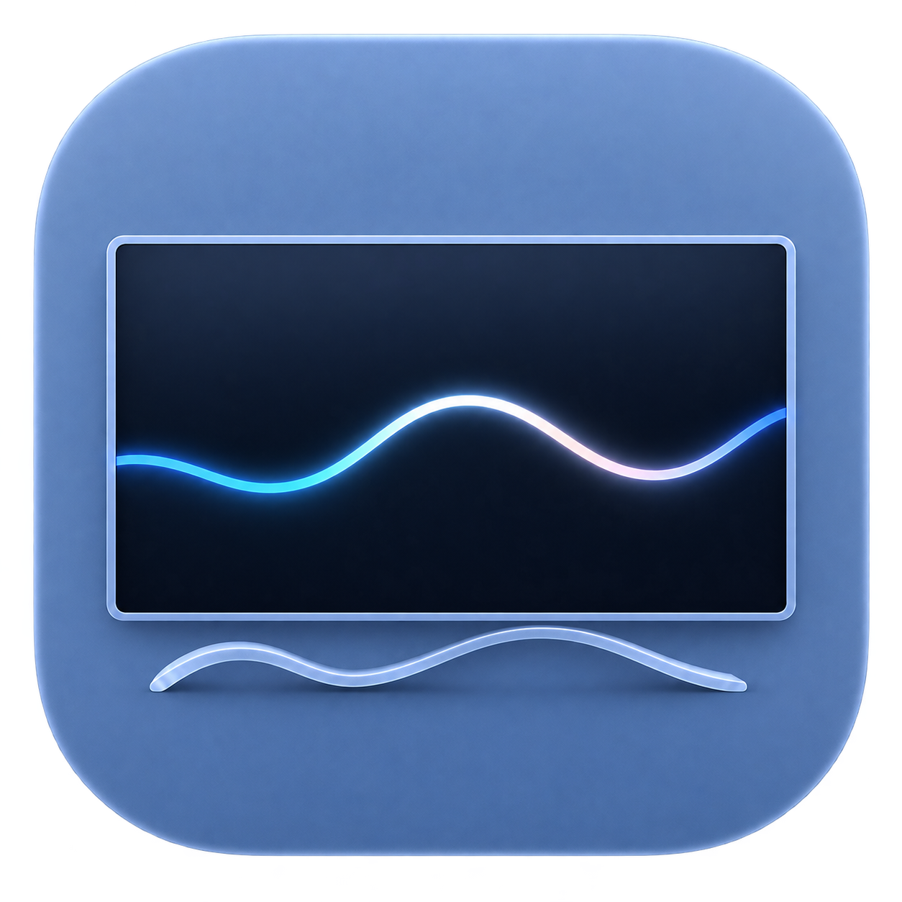
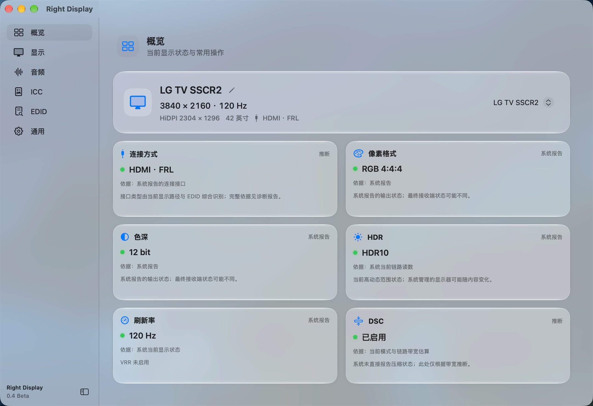

# RightDisplay

**Display status and everyday controls for your Mac.**

**RightDisplay 1.0.1 · Build46**

[Download 1.0.1](https://github.com/RedoRosetta/RightDisplay/releases/tag/v1.0.1) · [Installation](docs/installation/INSTALLATION.md#english) · [简体中文](README.md) · [Feedback](https://github.com/RedoRosetta/RightDisplay/issues/new/choose)

macOS14+ · Apple silicon

*The screenshot is a 0.4 development preview, not a new 1.0 capture or proof of device compatibility.*

## See and control

View resolution, HiDPI, refresh rate, HDR, color output and display capabilities. Access common controls from the menu bar, inspect EDID and ICC profiles, and use optional audio controls.

System-reported state is not a physical receiver measurement. EDID capability is not current output; DSC remains an inference; ICC charts describe profiles rather than measured screen performance. Virtual Audio adjusts forwarded audio, not television hardware volume, and separately requires macOS27+.

## 1.0.1 update

HDMI multichannel PCM conversion and explicit stereo-channel mapping improve the Virtual Audio software-volume path. Byte/bounds/layout and simulated output checks do not constitute new physical HDMI or wake acceptance. [Details](docs/releases/1.0.1.md).

## Install and trust

The 1.0.1 DMG is **Ad-hoc signed, not Developer ID signed, and not Apple notarized**. macOS may require its normal Privacy & Security → Open Anyway flow after you verify the download. Do not disable Gatekeeper or SIP. Follow the [current installation and removal guide](docs/installation/INSTALLATION.md).

Continuous playback, wake recovery and persistent manual-stop behavior passed the user's current-machine Build45 acceptance. The repackaged release received automated checks, not a new full hardware regression. Not all hardware/system combinations are verified, and not every historical dropout cause is resolved.

## Source and support

First-party material is **RNSL 1.0 Noncommercial Source Available**, not OSI Open Source. Apple/third-party material retains its original licenses; official brands remain reserved with the limited intact-package permission. See [LICENSE](LICENSE), [scope](LICENSE_SCOPE.md) and [third-party notices](docs/licensing/THIRD_PARTY_LICENSES.md).

[Building](docs/development/BUILDING.md) · [Architecture](docs/development/ARCHITECTURE.md) · [Contributing](CONTRIBUTING.md) · [Privacy](docs/installation/PRIVACY.md) · [Security](SECURITY.md) · [Repository structure](docs/REPOSITORY_STRUCTURE.md)

## History

1.0.1 Build46 is current. Older releases remain available; archived instructions do not apply to 1.0. [Changelog](CHANGELOG.md) · [1.0.1 notes](docs/releases/1.0.1.md) · [Archive](archive/README.md)

Feedback, testing and voluntary support are welcome. Review diagnostics for personal information before posting.

Copyright © 2026 RedoRosetta
