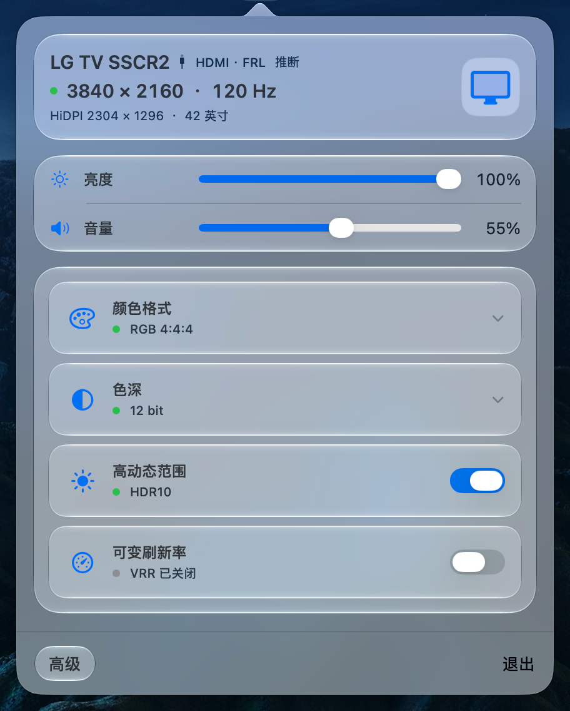
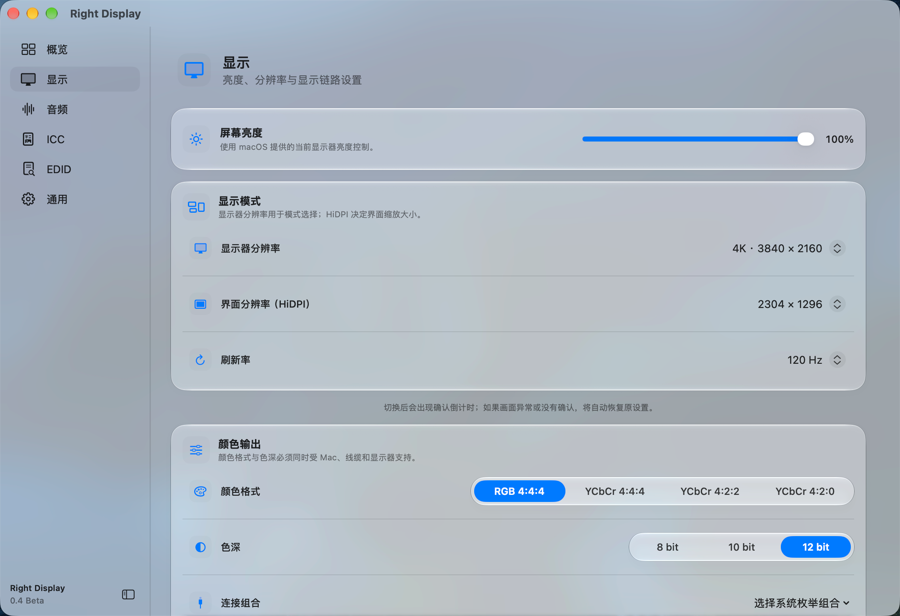
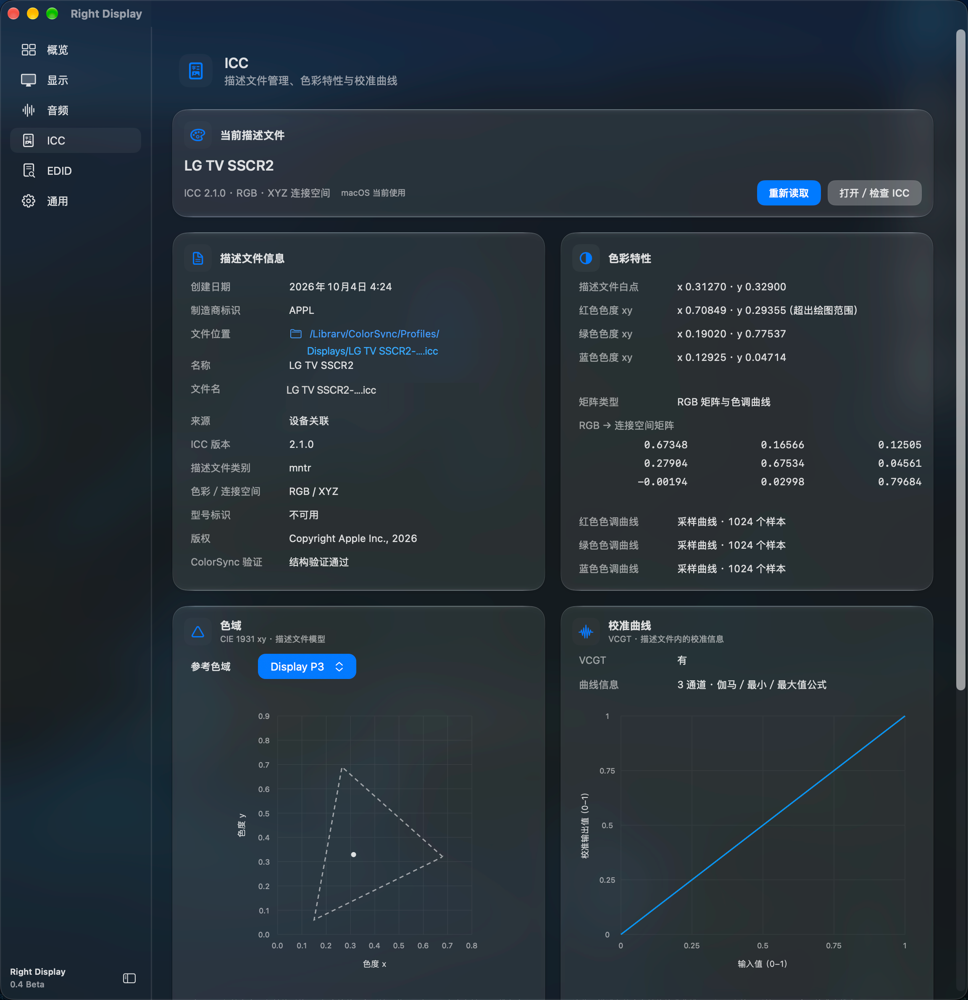
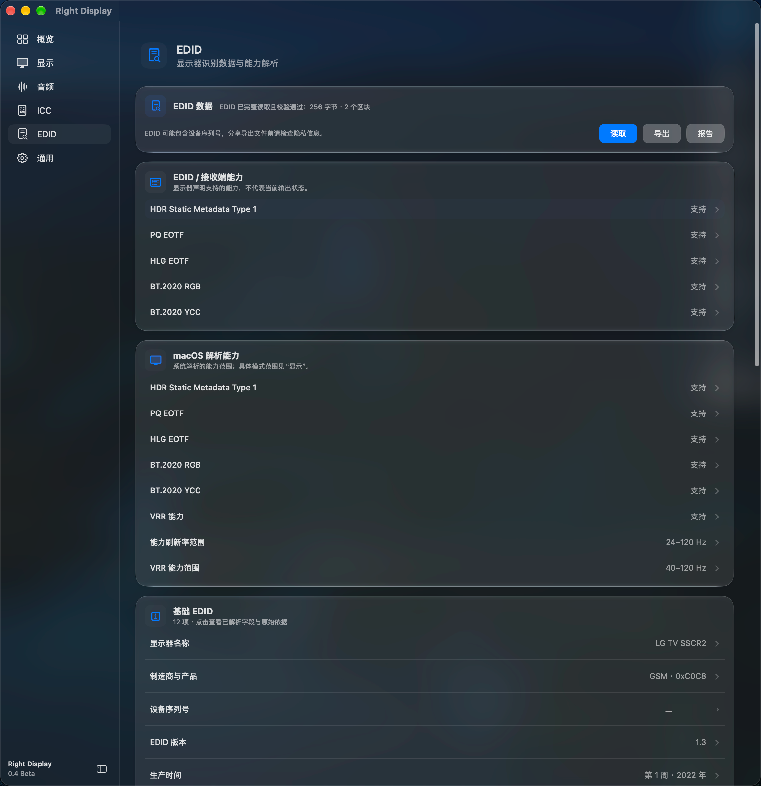
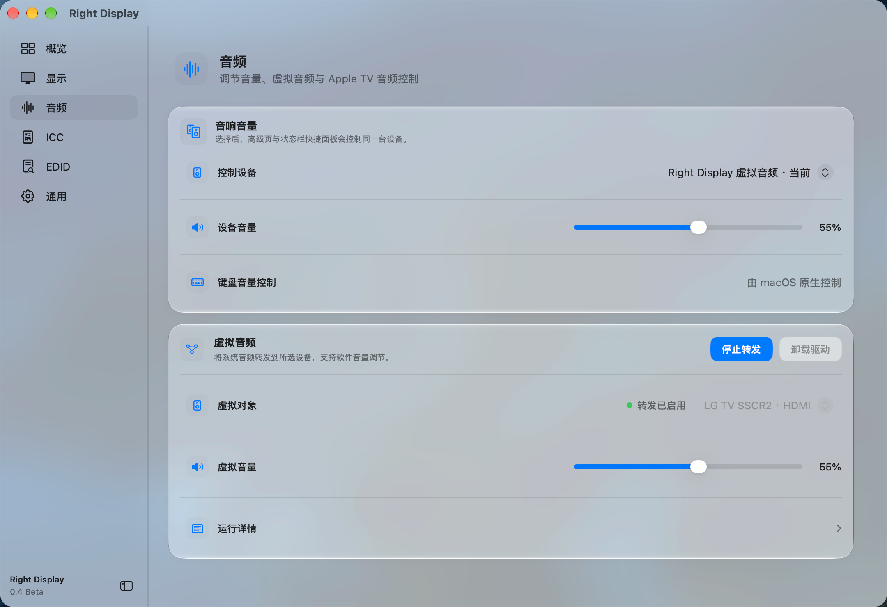
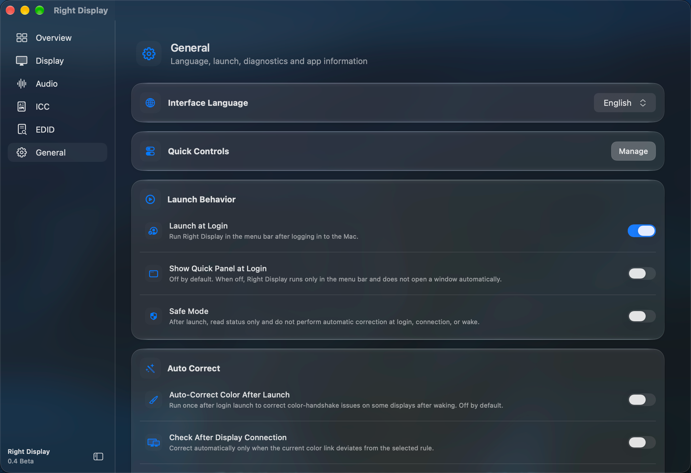

<div align="center">


# RightDisplay｜正确显示

**让 Mac 的显示输出，一目了然。**

一款专为 macOS 设计的显示器管理工具。  
查看显示状态、调整输出参数、管理色彩配置，并通过菜单栏快速控制常用功能。

**RightDisplay 1.0 · Build45**

[**下载 RightDisplay 1.0**](https://github.com/RedoRosetta/RightDisplay/releases/tag/v1.0.0) · [安装指南](docs/installation/INSTALLATION.md) · [反馈问题](https://github.com/RedoRosetta/RightDisplay/issues/new/choose) · [English](README.en.md)

macOS 14+ · Apple Silicon

</div>

---

<p align="center">
  
</p>

<p align="center">
  <sub>界面截图来自 0.4 Beta 阶段，实际界面可能随版本更新而有所变化。</sub>
</p>

## 认识你的显示器

RightDisplay 将 macOS 的显示信息集中在一个界面中，让你更容易了解当前连接的实际状态。

无需在多个系统设置页面之间切换，即可查看：

- **分辨率与 HiDPI** — 了解当前显示模式及缩放状态。
- **刷新率与 VRR** — 查看当前刷新率和可用的可变刷新率模式。
- **HDR** — 区分显示器声明的 HDR 能力与当前 HDR 状态。
- **颜色输出** — 查看 RGB / YCbCr、色深及输出范围。
- **设备信息** — 了解显示器识别信息、连接状态及系统提供的能力。

RightDisplay 会尽可能区分设备声明、macOS 报告和软件推断的信息。

需要注意，系统报告的输出状态不等于对显示器接收端进行的物理测量。

## 快捷控制，触手可及

不必每次都打开完整应用。

通过菜单栏中的 RightDisplay 图标，可以快速访问常用显示与音频控制。

<p align="center">
  
</p>

快捷面板支持按需配置，能够集中提供：

- 亮度控制
- 音量调节
- HDR 与 VRR
- 颜色格式与色深
- 常用显示设置

快捷面板与主窗口共享状态。

实际可用的控制项目取决于显示器、连接方式和 macOS 提供的接口。例如，部分 HDMI / DisplayPort 音频设备不支持系统直接调节硬件音量。

## 显示输出，由你掌控

在「显示」页面中，查看和调整当前连接可用的显示模式。

<p align="center">
  
</p>

RightDisplay 支持管理：

- 分辨率与 HiDPI 模式
- 固定刷新率及可用的 VRR 模式
- RGB / YCbCr 颜色格式
- 色深与输出范围
- HDR 输出
- 显示配置保护

显示模式以 macOS 为当前连接提供的能力为基础，不会将未经确认的模式冒充为硬件支持。

对于 `120 Hz` 和 `119.88 Hz` 等不同刷新时序，RightDisplay 会保留必要的区别。

部分显示设置可能导致短暂黑屏。需要确认的模式切换提供倒计时与恢复机制，但无法保证所有异常情况下都能成功恢复。

## ICC 色彩管理

查看、分析并管理显示器的 ICC 色彩描述文件。

<p align="center">
  
</p>

你可以查看：

- 当前使用的 ICC 描述文件
- 色彩原色与白点
- 色调响应曲线
- 色域关系
- VCGT 校准数据

也可以检查外部 ICC 文件，并在确认后应用可用的色彩描述文件。

**ICC 描述的是色彩配置模型，不等于显示器的实际测量结果。**

软件显示的色域图表不能替代色度计测量，也不代表 GPU 当前一定加载了对应的校准数据。

## EDID 设备信息

通过 EDID 查看显示器向系统声明的能力。

<details>
<summary>查看 EDID 界面</summary>

<br>

<p align="center">
  
</p>

</details>

包括：

- 显示器识别信息
- 支持的显示模式
- 刷新率相关能力
- HDR 能力声明
- VRR 相关信息
- 原始 EDID 数据导出

**EDID 声明支持某项功能，并不意味着当前连接已经启用了该功能。**

部分能力还取决于 Mac、连接接口、线材和 macOS 的实际支持情况。

导出的 EDID 数据可能包含设备序列号，分享前请检查。

## 音频控制与 Virtual Audio

RightDisplay 不仅关注画面，也提供与显示设备相关的音频控制能力。

### 常规音频控制

对于 macOS 允许调节音量的输出设备，可以直接使用应用或菜单栏进行控制。

RightDisplay 还提供兼容 Apple TV 的音量控制功能。

在相应连接和权限条件满足时，可以通过 Apple TV 控制路径管理音量及部分键盘操作。

这不代表应用能够直接控制所有 HomePod 或 AirPlay 音箱。

### Virtual Audio

**让不支持系统音量调节的 HDMI / DisplayPort 音频输出，也能通过软件控制音量。**

Virtual Audio 通过独立的虚拟音频路径，将系统声音转发至指定输出设备，并在转发过程中应用软件音量。

```text
系统音频
   ↓
RightDisplay Virtual Audio
   ↓
软件音量处理
   ↓
HDMI / DisplayPort 输出设备
```

<p align="center">
  
</p>

Virtual Audio 提供：

- 指定真实音频输出设备
- 软件音量调节
- 条件满足时自动启动
- 设备与运行状态管理
- 唤醒后的恢复处理
- 保留用户手动停止状态

在 **RightDisplay 1.0 · Build45** 的本机验收中，以下三项测试已经通过：

| 测试项目 | 结果 |
|---|---|
| 持续音频播放 | PASS |
| 系统唤醒后恢复 | PASS |
| 手动停止后不自动恢复 | PASS |

正式分发包还通过了 Ad-hoc 签名、组件绑定、XPC 安全校验和 DMG 挂载等自动化检查。

需要说明的是，最终重打包后的版本未进行完整实机回归，因此上述结果不代表所有 Mac、macOS 版本及音频设备组合均已验证。

Virtual Audio 是可选功能。使用显示管理、ICC、EDID 等功能不需要安装虚拟音频组件。

## 下载与安装

### 下载 RightDisplay 1.0

**[前往 GitHub Releases 下载正式版](https://github.com/RedoRosetta/RightDisplay/releases/tag/v1.0.0)**

当前版本：

| 项目 | 信息 |
|---|---|
| 版本 | 1.0 |
| Build | 45 |
| 平台 | macOS |
| 处理器 | Apple Silicon |
| 安装包 | DMG |
| 签名 | Ad-hoc |
| Apple 公证 | 未公证 |

安装步骤：

1. 从 GitHub Releases 下载 RightDisplay 1.0 的 DMG。
2. 打开 DMG，将 `Right Display.app` 拖入「应用程序」文件夹。
3. 从「应用程序」启动 RightDisplay。
4. 根据需要授予相关权限，并配置显示或音频功能。

### 关于 macOS 安全提示

RightDisplay 1.0 使用 Ad-hoc 签名，**尚未经过 Apple 公证**。

因此，macOS 可能阻止应用首次打开，并显示无法验证开发者或无法检查应用安全性的提示。

请确认安装包来自本项目官方 GitHub Release。

如果 macOS 阻止打开，可以尝试启动应用，然后前往：

**系统设置 → 隐私与安全性 → 仍要打开**

按照系统提示完成确认。

不需要全局关闭 Gatekeeper，也不需要关闭 SIP。

部分系统级音频功能可能受到 macOS 版本、权限和组件加载策略的限制。

更多信息请参阅 [安装指南](docs/installation/INSTALLATION.md)。

### 文件完整性

RightDisplay 1.0 · Build45 官方 DMG：

**SHA-256**

```text
ae1964e06ed83b54ab5ec60cd20ef8820f4c68c6e5eecc14fc1a87f51c1c7f3e
```

可以在终端中使用以下命令验证下载文件：

```bash
shasum -a 256 RightDisplay-1.0-Build45.dmg
```

计算结果应与上方 SHA-256 一致。

## 设置与诊断

RightDisplay 提供中文和英文界面。

应用包含六个主要页面：

**概览 · 显示 · 音频 · ICC · EDID · 通用**

在「通用」页面中，可以管理语言、登录启动行为、快捷控制项目及部分自动校正设置。

<details>
<summary>查看通用设置界面</summary>

<br>

<p align="center">
  
</p>

</details>

当遇到显示模式异常、设备识别问题或功能不可用时，可以按需导出诊断报告。

诊断报告由用户主动保存到本地，不会因为使用该功能而自动上传。

分享报告前，请检查其中可能包含的设备名称、序列号、网络信息和本地路径。

[查看隐私说明](docs/installation/PRIVACY.md)

## 源码与许可证

RightDisplay 的首方源码以 **RightDisplay Noncommercial Source License（RNSL）1.0** 提供。

这是一个 **Source Available（源码可见）** 项目。

你可以按照 RNSL 1.0 的具体条款查看、使用、研究和修改首方源码。

商业使用需要取得相应授权。

RNSL 1.0 包含非商业限制，因此不属于 OSI 定义的开源许可证。

Apple 原始材料及其他第三方组件继续遵循各自的许可证，RNSL 不会取代这些既有授权。

相关文档：

- [RNSL 1.0 许可证](LICENSE)
- [第三方许可证](docs/licensing/THIRD_PARTY_LICENSES.md)
- [版权及第三方声明](NOTICE.md)
- [从源码构建](docs/development/BUILDING.md)
- [项目架构](docs/development/ARCHITECTURE.md)
- [参与贡献](CONTRIBUTING.md)

## 反馈与支持

RightDisplay 仍会持续维护和改进。

如果遇到问题，欢迎通过 GitHub Issues 反馈：

**[报告问题或提出建议](https://github.com/RedoRosetta/RightDisplay/issues/new/choose)**

反馈时，建议提供：

- RightDisplay 版本
- Mac 型号及 macOS 版本
- 显示器或音频设备型号
- 实际发生的问题
- 预期行为

如需附上诊断文件，请先检查个人信息。

<a id="support"></a>

如果 RightDisplay 对你有帮助，也欢迎自愿支持项目开发。

使用、测试和反馈同样是对项目的支持。

## 历史版本

RightDisplay 1.0 是当前正式发布版本。

此前的 0.4 Beta RC 已作为历史版本保留：

[查看历史 Release](https://github.com/RedoRosetta/RightDisplay/releases) · [更新记录](CHANGELOG.md)

---

<div align="center">

**RightDisplay｜正确显示**

让显示状态更清晰，让常用控制更简单。

Copyright © 2026 RedoRosetta

</div>

[源码构建](docs/development/BUILDING.md) · [仓库结构](docs/REPOSITORY_STRUCTURE.md) · [许可证与依赖](docs/licensing/THIRD_PARTY_LICENSES.md)
